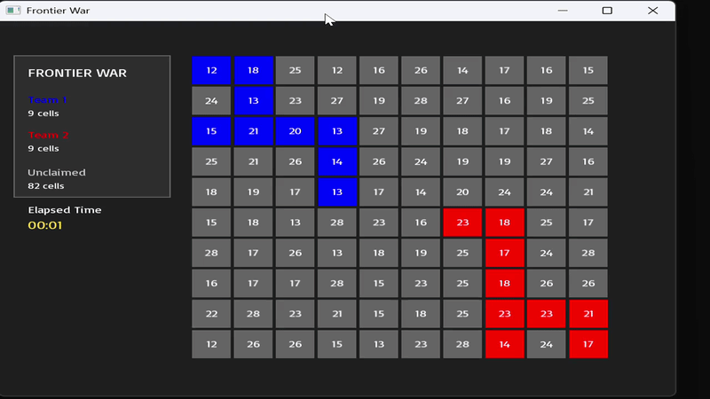

# ⚔️ Frontier War

**A multithreaded territory-control simulation built with C++ and SFML.**

Frontier War is a simulation where two teams compete to claim cells on a shared 10 × 10 grid. Each cell has a randomly assigned difficulty, and CPU worker threads must find a valid hash before attempting to claim it.

I'm building this project to learn more about C++ multithreading, atomic operations, and how multiple workers coordinate access to shared memory. My next goal is to introduce CUDA so GPU threads can compete against CPU threads on the same board.

## Demo

## Concepts

- **Multithreading:** Running four CPU workers concurrently.
- **Atomic operations:** Preventing competing workers from successfully claiming the same cell.
- **Hashing:** Using a SplitMix64-style function to generate candidate proof-of-work results.
- **Concurrency:** Managing competing access to a shared board.
- **SFML:** Visualizing territory ownership and worker activity in real time.

## How It Works

- Two teams begin in opposite corners of a 10 × 10 grid.
- Each cell has a randomly assigned difficulty that determines how hard it is to find a valid hash.
- Four CPU worker threads search for valid hashes and compete to claim eligible cells.
- Atomic operations ensure that only one team can claim a cell.
- The simulation continues until every cell has been claimed.

## Built With

- C++
- SFML 3

## Future Improvements

- Implement CUDA kernels to introduce GPU workers.
- Allow CPU and GPU threads to compete on the same board.
- Explore performance differences between CPU and GPU approaches.
